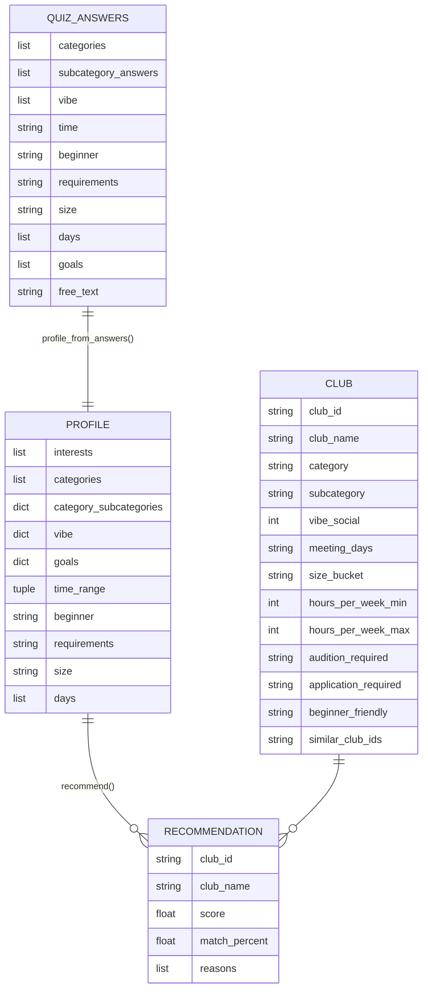

# Architecture & Data Guide

How the club recommender's data is structured, how the code is organized, and what happens end-to-end when someody takes the quiz.

---

## Data model

There are four data shapes and their respective fields



### a. Club dataset (stored)

**File:** `data/UPDATED_cornell_clubs_rich_dataset.xlsx - Clubs.csv`. It has 679 clubs total, each with 57 columns. There are 16 categories, 73 subcategories. In the dataset one row is one club.

Here are the columns and what they basically fall under:

| Group | Columns |
|---|---|
| Identity | `club_id`, `club_name`, `category`, `subcategory` |
| Descriptive text | `summary`, `description`, `interest_tags`, `skills_gained`, `good_for`, `match_text`, `vibe_tags` |
| Vibe scores (1–5) | `vibe_social`, `vibe_competitive`, `vibe_creative`, `vibe_relaxed`, `vibe_physical`, `vibe_intellectual`, `vibe_performance`, `vibe_service` |
| Schedule | `meeting_days`, `meeting_start_time`, `meeting_length_min`, `meetings_per_month`, `meeting_frequency`, `typical_location`, `meeting_format`, `typical_meeting` | `meeting_days` |
| Commitment | `hours_per_week_min`, `hours_per_week_max`, `commitment_level`, `semesters_active`, `events_per_semester`, `typical_events` |
| Eligibility | `audition_required`, `application_required`, `beginner_friendly`, `membership_type`, `experience_required`, `accepts_midyear`, `recruitment_period`, `dues_usd_per_semester`, `open_to_grad_students` |
| Size | `member_count_est`, `size_bucket`, `year_founded`, `popularity_score`, `instagram_followers` | `size_bucket` |
| Community | `identity_tags`, `community_tags`, `identity_focus_level` |
| Links | `instagram_handle`, `website_url`, `chat_platform` |

### b. Quiz answers (from the browser)

The frontend keeps an `answers` object like so. Keys are essentially questions and values are options. Here's an example of what that looks like:

```json
{
  "categories": ["music", "outdoors"],
  "music": ["a_cappella"],
  "outdoors": ["hiking"],
  "vibe": ["social", "creative"],
  "time": "3_5",
  "beginner": "very",
  "requirements": "either",
  "size": "medium",
  "days": ["wednesday", "sunday"],
  "goals": ["meet_people", "fun"],
  "free_text": "I want a close-knit group"
}
```

### c. Profile (normalized answers)

`profile.py` maps option ids to the labels used in the dataset. This is just a intermediary step in the whole design flow.

```json
{
  "interests": ["Music & Singing", "Outdoors, Nature & Animals", "A Cappella", "Hiking & Camping"],
  "categories": ["Music & Singing", "Outdoors, Nature & Animals"],
  "category_subcategories": {
    "Music & Singing": ["A Cappella"],
    "Outdoors, Nature & Animals": ["Hiking & Camping"]
  },
  "vibe": {"social": 1.0, "creative": 1.0},
  "goals": {"meet_people": 1.0, "fun": 1.0},
  "time_range": [3, 5],
  "beginner": "very",
  "requirements": "either",
  "size": "medium",
  "days": ["wednesday", "sunday"],
  "free_text": "I want a close-knit group"
}
```

### d. Recommendation

The reccs are given like so.

```json
{
  "club_id": "CU-0001",
  "club_name": "<3 A Cappella",
  "category": "Music & Singing",
  "subcategory": "A Cappella",
  "summary": "A cappella singing group.",
  "score": 0.65,
  "match_percent": 65.0,
  "reasons": ["matches your interests", "fits your preferred vibe",
              "fits your preferred time commitment", "beginner-friendly"]
}
```

---

## 2. Code workflow

**1. Adaptive quiz (`quiz.py`).** The first question is always `categories`. Each selected category adds one follow-up question with subcategories. Then there are 8 common questions (`vibe → time → beginner → requirements → size → days → goals → free_text`). 

**2. Normalization (`profile.py`).** The options that were chosen are mapped to the exact category and subcategory labels used in the CSV. This is more like a data management step that translates user choices to code the algorithm can ingest and understand.

**3. Filter (`recommender.hard_filter`).** A club is dropped if any of these is true:
- `requirements == "avoid"` and the club requires an audition or an application.
- `beginner == "very"` and the club isn't beginner-friendly.

**4. Scoring.** Each club that passes gets a weighted sum of four scores. Each between 0 and 1, shown below

```
score = 0.40·interest + 0.30·vibe + 0.15·logistics + 0.15·commitment
```

This takes into account the interest overlaps, the vibe the user is looking for, the time logistics so the user can actually attend the club reccomendations if possible, and the commitment level the user wants.

**5. Explanations.** Components above a threshold become "reasons" that are displayed (for example interest ≥ 0.5 outputs  "matches your interests"). Top 4 are displayed.

**6. Ranking and category balancing.** Results are sorted by score. There is a unique element to the ranking that shows multiple categories so there is diversity. Essnetially they are picked round-robin style, until the `top_n` are reached.

---